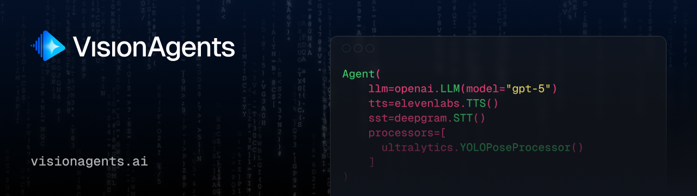

Fast, Go based, backend for building voice, video and text agents. 
Build AI/agentic apps like Muse, Decagon and Harvey in days.

* Go: Python no longer makes sense now that we all write code in English with Claude
* Build Quickly: The SDKs, routing, acceleration, connectors and other features make it fast to build complex agents.
* Performance: Go, WARP and edge servers ensure excellent performance

## SDKs

The heavy lifting is done in Go. But you can use the agents in any environment:

Client side SDKs with Chat/Video/Audio support: Swift, Kotlin, React, Flutter, React Native

Backend SDKs: Python, Go, Node, Ruby, PHP, .NET, Rust

## Quickstart

See the [quickstart docs](https://getstream.io/agents/docs/quickstart/)


## Agent Folders and CLI

The fastest way to define an agent is using the folder structure

You can quickly create a folder using the CLI

```bash
curl -fsSL https://getstream.io/cli/beta/install.sh | bash
getstream agents init my-agent --template text
```

The structure looks something like this:

```text
agents/my-agent/
  knowledge/       ← indexed markdown and URLs
    faq.md
    urls.yaml
  skills/          ← skills loaded as needed
    research.md
  simulations/
  agent.yaml       ← config for the agent
  routing.yaml     ← routing
  instructions.md  ← system prompt
  guardrail.md     ← prevent abuse
```

After you create an agent you can quickly test it like this

```bash
getstream agents test my-agent
```

Note that you can also configure agents through the SDKs or dashboard.

## Tool Calling

You can set up tool calling with any language.

```golang
package main

import (
	"context"
	"errors"

	"github.com/GetStream/Vision-Agents/sdks/go/agents"
	"github.com/GetStream/Vision-Agents/sdks/go/client"
	"github.com/GetStream/Vision-Agents/sdks/go/stream"
	"github.com/GetStream/Vision-Agents/sdks/go/tools"
)

func customerCaseLookup(ctx context.Context, _ struct{}) (any, error) {
	user := tools.ToolCallContextFrom(ctx).User
	if user.ID == "" {
		return nil, errors.New("unknown user")
	}
	// pretend this calls your CRM
	return crm.OpenCases(ctx, user.ID)
}

func main() {
	api, _ := client.New(stream.Backend{})
	agent := api.Agent("my-agent")
	tools.Register(agent.Tools(), "customer_case_lookup",
		"Look up the user's open support cases", customerCaseLookup)

	dispatch, _ := agents.NewDispatch(agents.DispatchOptions{})
	dispatch.Host(agent, 0)
	dispatch.Run(context.Background())
}
```

```python
import asyncio

from vision_agents.core.llm import ToolCallContext
from vision_agents.plugins import stream

agent = stream.Client().agent("my-agent")


@agent.register()
async def customer_case_lookup(tool_call_context: ToolCallContext) -> list:
    "Look up the user's open support cases"
    user = tool_call_context.user
    if not user.id:
        raise ValueError("unknown user")
    # pretend this calls your CRM
    return await crm.open_cases(user.id)


dispatch = stream.Dispatch()
dispatch.host(agent)
asyncio.run(dispatch.run())
```


## Features included

* Acceleration: Go + Edge servers means amazingly fast agents
* Voice & Video
* Routing for LLM and STT
* Connectors for Slack/WhatsApp/Linear etc
* Tools & MCP
* Telephony
* Cost controls
* Memory & knowledge
* Chat/agent persistence
* Sandbox/VM
* Search
