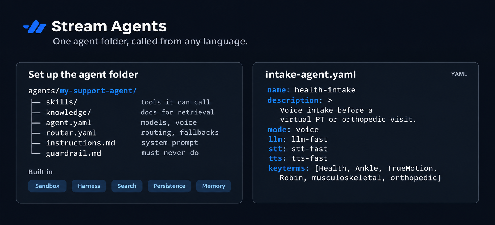

> [!NOTE]
> Using Python for Agents no longer makes sense. 0.7 is a move to Go, with SDKs for other languages.

Stream Agents is a Go backend for building voice, video and text agents.
You can build AI/agentic apps like Muse, Decagon and Harvey in a day.

#### It's faster to build agents:

1. Agents are defined in a folder structure + YAML
2. SDKs handle chat/audio client and state
3. All the components you need are integrated with sensible default. (Guardrails, Knowledge, Routing, Connectors, Sandboxes, skills, telephony)

#### Performance is excellent:

1. Go runs with high concurrency and raw performance
2. The edge acceleration offloads your backend and lowers latency
3. Audio forwarding is optimized with WARP similar to OpenAI

#### Sovereign AI

The combination of routing, persistence and memory makes it easy to switch the underlying models.
Stay in control of how you use the frontier models, how costs scale and run on your own when it makes sense.

## Quickstart

The heavy lifting is done in Go. But you can use the agents in any environment:

Pick your backend language:

* [Python](https://getstream.io/agents/docs/quickstart/?server=python)
* [Go](https://getstream.io/agents/docs/quickstart/?server=go-golang)
* [Node](https://getstream.io/agents/docs/quickstart/?server=javascript)
* [Ruby](https://getstream.io/agents/docs/quickstart/?server=ruby)
* [PHP](https://getstream.io/agents/docs/quickstart/?server=php)
* [.NET](https://getstream.io/agents/docs/quickstart/?server=dotnet-csharp)
* [Rust](https://getstream.io/agents/docs/quickstart/?server=rust)

Then add chat, voice and video to your app with a client SDK:

* [Swift](https://getstream.io/agents/docs/quickstart/?client=swift)
* [Kotlin](https://getstream.io/agents/docs/quickstart/?client=kotlin)
* [React](https://getstream.io/agents/docs/quickstart/?client=react)
* [Flutter](https://getstream.io/agents/docs/quickstart/?client=flutter)
* [React Native](https://getstream.io/agents/docs/quickstart/?client=react-native)


## Agent Folders and CLI

The fastest way to define an agent is using the folder structure

You can quickly create a folder using the CLI

```bash
curl -fsSL https://getstream.io/cli/beta/install.sh | bash
getstream agents init my-agent --template text
```

The structure looks something like this:

```text
agents/my-agent/
  knowledge/       ← indexed markdown and URLs
    faq.md
    urls.yaml
  skills/          ← skills loaded as needed
    research.md
  simulations/
  agent.yaml       ← config for the agent
  routing.yaml     ← routing
  instructions.md  ← system prompt
  guardrail.md     ← prevent abuse
```

After you create an agent you can quickly test it like this

```bash
getstream agents test my-agent
```

Note that you can also configure agents through the SDKs or dashboard.

## Tool Calling

You can set up tool calling with any backend language. Here's Python.

Register your functions on the agent, then host them with a `Dispatch` worker. The worker
connects out to the router, so it needs no public URL, and every session with the agent can
call its tools: chat, voice or phone, opened from your backend or from a user's browser. Run
more workers and the router spreads the calls between them.

```python
import asyncio

from vision_agents.core.llm import ToolCallContext
from vision_agents.plugins import stream

agent = stream.Client().agent("my-agent")


@agent.register()
async def customer_case_lookup(tool_call_context: ToolCallContext) -> list:
    """Look up the user's open support cases."""
    user = tool_call_context.user
    if not user.id:
        raise ValueError("unknown user")
    await tool_call_context.update("Checking your open cases")
    # pretend this calls your CRM
    return await crm.open_cases(user.id)


async def main() -> None:
    dispatch = stream.Dispatch()
    dispatch.host(agent, tool_timeout=30)
    await dispatch.run()


asyncio.run(main())
```

## Client Side/ Browser & App

You can create a session for persistence.
After the session is created, you can uses responses.create across all supported LLMs.

```ts
import { Client } from "@stream-io/stream-agents";

const api = new Client({ apiKey: "your_api_key" });
await api.setUser("jlahey", userToken); // a token your backend minted for this user

const session = await api.agent("support").sessions.create();
await session.responses.create("Do I have any open support cases?");

for await (const event of session.events()) {
  if (event.kind === "response_delta") console.log(event.text);
  if (event.kind === "responded") break;
}
```

Also note how the agent is referenced by use case. IE "support" and not the name of the model.
The design here is that it should be trivial to switch from a frontier model to open or your own.

Full apps with chat, voice and tools, one per client SDK:

* [Kotlin](examples/voice_agents/android_assistant)
* [Swift](examples/voice_agents/swift_assistant)
* [React Native](examples/voice_agents/react_native_assistant)
* [React](examples/voice_agents/react_assistant)
* [Flutter](examples/voice_agents/flutter_assistant)

## Examples / What can you build

* Simple chat: text, knowledge, skills, function calling, a connector and an MCP server
* [Simple voice](examples/voice_agents/simple_voice_ai)
* [Inbound calling](examples/voice_agents/restaurant_orders): answers a restaurant's number and takes an order
* [Outbound calling](examples/voice_agents/recruiter_voice): rings a candidate and screens them
* Video: [security camera](examples/video_agents/security_camera), avatar
* Artemis and Awesome No Moat: coming soon

## Features included

* [Acceleration](https://getstream.io/agents/docs/): Go + Edge servers means amazingly fast agents
* [Voice](https://getstream.io/agents/docs/quickstart/) & [Video](https://getstream.io/agents/docs/video/)
* [Routing](https://getstream.io/agents/docs/router-intro/) for [LLM](https://getstream.io/agents/docs/llm/) and [STT](https://getstream.io/agents/docs/stt/)
* [Connectors](https://getstream.io/agents/docs/connectors/) for [Slack](https://getstream.io/agents/docs/connectors/slack/)/[WhatsApp](https://getstream.io/agents/docs/connectors/whatsapp/)/Linear etc
* [Tools](https://getstream.io/agents/docs/tool-calling-and-dispatch/) & [MCP](https://getstream.io/agents/docs/connectors/mcp/)
* Telephony: [accepting calls](https://getstream.io/agents/docs/telephony/accepting-calls/) and [making calls](https://getstream.io/agents/docs/telephony/making-calls/)
* [Cost controls](https://getstream.io/agents/docs/spend-limits/)
* [Memory](https://getstream.io/agents/docs/memory-and-persistence/) & [knowledge](https://getstream.io/agents/docs/knowledge-and-skills/)
* Chat/agent persistence, see [sessions](https://getstream.io/agents/docs/sessions/)
* [Sandbox/VM](https://getstream.io/agents/docs/harness-and-sandbox/)
* [Search](https://getstream.io/agents/docs/creating-an-agent/)

## Connectors

Connectors give an agent a provider's tools, or let people talk to it on a messaging channel.
Add one in `agent.yaml` or the dashboard, with no code. Any other MCP server can be added as a
custom connector. See the [connectors docs](https://getstream.io/agents/docs/connectors/).

* Messaging channels: Slack bot, WhatsApp, SMS (Telnyx), iMessage (Linq)
* Communication: Slack, Gmail
* Documents: Notion, Google Docs, Google Drive
* Scheduling: Google Calendar, Calendly, Cal.com
* Project management and engineering: Linear, GitHub, Sentry
* Customers and revenue: Salesforce, HubSpot, Gong
* Commerce: Shopify, Instacart
* Analytics: BigQuery, Metabase

## Benchmarks (coming soon)

* Agent development speed
* Edge performance
* Agent concurrency
* Voice benchmark

## Alternatives

How Stream Agents compares to the alternatives, see
[Stream vs alternatives](https://getstream.io/agents/docs/alternatives/):

* OpenAI or Anthropic directly
* Agent frameworks: Eve, AI SDK, LangChain
* Routers: OpenRouter, Bifrost, LiteLLM
* Voice AI frameworks: LiveKit, Pipecat, Retell, Agora, Vapi
* Support SaaS: Sierra, Decagon, Serval

